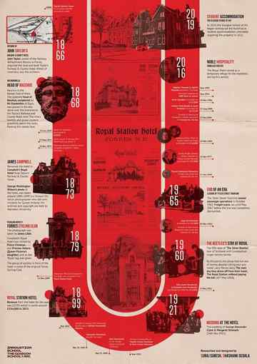

# 案例1分析｜Royal Station Hotel 历史时间轴

**图形类型：** 时间轴型信息图形（U形时间主轴＋事件注释模块）  
**基本数据逻辑：** 编年型

## A. 基本数据逻辑

以事件发生的年份、日期为主要索引，将 Royal Station Hotel 的历史事件按时间先后组织。两侧事件虽然以独立图文模块呈现，具有类似编目式的分块外观，但整体排列和阅读顺序由时间决定，因此主导逻辑是**编年型**，不是编目型。

## B. 统计图形与计算方式

- **图形：** 时间轴图（Timeline）与里程碑事件图（Milestone Timeline）。
- **组织方式：** 按年份、日期排序，以节点标记事件，并用文字和图片补充事件信息。
- **计算：** 可用年份相减表示事件间隔；若有明确起止日期，可计算阶段持续时间。
- **说明：** 案例主要使用时间排序，没有明显采用均值、比例、频率或回归等统计计算；画面中的节点间距主要服务于版面组织，不能直接视为严格按时间比例绘制。

## C. 视觉编码

- **点：** 圆点定位事件，圆形人物肖像突出相关人物。
- **线：** 中央U形红色主轴串联时间节点，细线连接节点与两侧说明。
- **面：** 红色大面积色块构成主体，米白色背景承载文字并形成分区。
- **体：** 建筑与人物照片通过裁切、叠加和明暗对比形成层次感；并非用三维体积表达定量数据。
- **符号：** 年份数字、人物肖像、建筑照片及历史场景作为识别符号。
- **色彩与文字：** 红、黑、米白形成高对比；年份、标题和正文通过字号、字重与位置建立层级。

## D. 数据／信息架构

采用“**时间主轴＋事件分支**”结构。时间是一级索引；每个事件模块包含日期或年份、事件标题、简短说明及相关人物／建筑图像。中央主轴负责建立整体顺序，左右两侧模块负责解释具体事件。

## E. 视觉叙事架构

采用U形连续路径引导阅读：从左侧较早时期开始，沿左侧向下阅读，经过底部时间转折后转向右侧，再沿右侧向上延伸至较近时期。通过历史事件、人物和建筑影像，把酒店从早期发展到现代用途的变化组织成连续叙事。

## 结论

该案例的**数据架构逻辑为编年型，视觉图形类型为时间轴型**。判断重点不是事件模块是否独立，而是事件的主排序依据是否为时间。若时间决定整体先后，即使采用卡片式、图文分栏式呈现，仍可属于编年型；若主要按主题或类别归组、时间只作为辅助标签，则更接近编目型。
